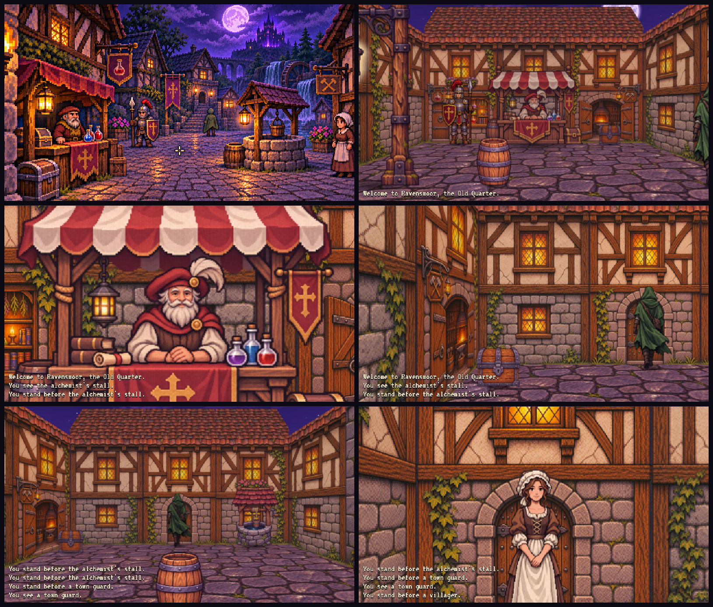

# 2D compositing — experiment 2 (`game-2/`)

The 3D renderer (experiment 1, `game-1/`) is paused. Its problems were structural:
the floor reads as mediocre 3D, per-surface shading makes it look less painted,
distant objects lose detail, and the open square puts everything far away.
Facades and characters looked good up close.

Experiment 2 draws every view by **compositing pre-painted images**, like Eye of
the Beholder, on a **small map where you never see far**.



Concept art (top left), then the demo with placeholder art, baked from experiment 1's
sprites and textures: the courtyard from the start tile; standing on the alchemist's
stall's tile and facing it; the same tile facing east, where the stall is gone; a barrel
on the near side of the next tile; and standing on the villager's tile, facing her.

## Running the demo

The page loads ES modules, so serve the repository root with any static server and
open `/game-2/index.html`:

```
python -m http.server 8000      then open http://localhost:8000/game-2/index.html
```

**W/S** or **↑/↓** move, **A/D** strafe, **Q/E** or **←/→** turn, **O** shows the slot
outlines. The log over the view names what you stand before or see ahead, and the
minimap marks named NPCs and props. There is no build step, and the only network use
is the web fonts.

## How a view is drawn

The player stands in a cell facing N, E, S or W, so every possible view is a
one-point perspective of the same grid. Each thing that can appear on screen
(a wall face or an object in a cell) can only appear in a fixed set of screen
positions, called **slots**. Each slot has its own painted image:

- `front-d<d>-l<l>`: the face of a wall `d` cells ahead and `l` cells to the side,
  facing the player.
- `side-d<d>-l<l>`: the face of that wall turned towards the centre line, seen at
  an angle.
- `prop-<side>-d<d>-l<l>`: an object or NPC standing in that cell, against one side of
  it: `far` (away from the player), `near` (towards the player), `left` or `right`.

Left-side slots are the right-side images mirrored, so only `l >= 0` is stored.

### Props stand against tile sides

A prop never stands in the middle of a cell. Each entity in a level names the side
of its tile it stands against (`side: 'N' | 'E' | 'S' | 'W'`, at most one per side),
and the engine turns that into far, near, left or right depending on which way the
player faces. Nothing blocks a tile, so the player can walk onto a tile with an NPC.

In the player's own cell only the `far` side is drawn: the other sides are beside or
behind the camera. So an NPC on your tile is visible only while you face its side,
and then it is big, with its feet below the frame (`prop-far-d0-l0`). From a
neighbouring tile it is seen on the near or far side of that tile, or beside the path.

The compositor (`engine2d/`) draws the following, far to near:

1. the backdrop for the facing direction
2. the floor, mirrored on alternate steps so walking reads as movement
3. side faces, then props, then fronts, for each row from depth 3 down to 0

Movement is instant with a short crossfade.

```
 depth 3   F F F F F       S = side faces, seen at an angle
 depth 2    S F F F S      F = front faces, seen straight on
 depth 1     S F F S       @ = player (camera 0.4 tiles behind the cell centre)
 depth 0       S@S
```

Geometry lives in `engine2d/view.js` (`DEFAULT_VIEW`): 640×360 view, 50° vertical
field of view, eye at 0.55 tiles, drawn depth 3. With these settings each wall type
needs **16 images** and each prop **24–27** (14 for the stall, which is too wide to
stand beside a side wall). A prop slot that is partly off screen reuses the image of
the nearest whole slot in the same row, because props at the same depth are the same
size; where there is no whole slot (the prop on your own tile) it is painted as far
as it shows.

### Map rules

- Lines of sight stay short, so walls close every view within the drawn depth
  (`maxDepth` 3). Anything beyond shows the backdrop.
- Wall types are cheap to add (16 images each), so variety comes from many
  types, not from rules.
- `game-2/quarter.js` is a 3×3 courtyard (nine walkable cells) inside a ring of
  buildings that uses all six wall types, with ten props and NPCs on tile sides.
- To keep the art small, shrink the map or the number of wall and prop types. Don't
  lower `maxDepth`: the drawn depth is part of the look.

### Authoring a level

A level is a plain object (`game-2/quarter.js` is the example):

- `tiles`: rows of characters, `x` growing east and `z` growing south. `.` is floor;
  every other character is a wall type from `tileTypes`, whose `art` names the folder
  under `assets/walls/`. Surround the open area with walls.
- `start`: `{ x, z, dir }`, with `dir` 0–3 for N, E, S, W.
- `props` (the prop library): `art` (the folder under `assets/props/`) and the size
  `w`, `h` in tiles, which must match the art's proportions. A prop wider than about
  0.76 tiles can only stand against a far or near side, not a side wall. Give a prop that has
  separate side art its `sideW` (its width seen from the side), and that is what counts instead:
  the stall is 1.295 wide but 0.475 from the side. See `docs/prop-views-test.md`.
- `entities`: `{ prop, name?, x, z, side }`. `side` is the tile side it stands
  against (N, E, S or W), at most one entity per side. A `name` puts it on the minimap
  and in the log; without one it is scenery. Entities never block movement.
- `view` (optional): overrides for `DEFAULT_VIEW`. The wall and prop slots follow from
  the geometry, so changing it means baking and painting the art again.

On start-up the game rejects an entity that has no valid side, is not on a floor tile,
names an unknown prop, or shares a side with another entity, and says which one.

To add a prop, add it to `props`, map its placeholder sprite in `SOURCE.props`
(`tools/studio2d/studio.js`), then run `bake props` and `guides`.

## Making the art

Painting about 100 wall images and 220 prop images one by one would be slow and
inconsistent. Instead, slots are painted **together**: one image generation paints
a sheet of four panels, and the panels are cut back into slots.

```
node tools/studio2d.mjs bake       placeholder slots from experiment 1's art (what you see now)
                                   (optionally only: bake props, bake walls floor, ...)
node tools/studio2d.mjs guides     game-2/art/guides/<sheet>.png + <sheet>.key.png + plan.json
node tools/studio2d.mjs paint <sheet>   repaint a guide with a local ComfyUI (docs/art-prompts-2d.md)
   ... paint each guide with the image model (docs/art-prompts-2d.md) ...
node tools/studio2d.mjs slice <sheet> <painted.png>   cut into game-2/assets/
```

- **Guide sheets** (`game-2/art/guides/`) are 1536×1024 with four 16:9 panels. Each
  panel is a real view of a few cells, rendered with the placeholders on a flat
  magenta background. Paint over the guide (image-to-image), keeping every
  outline in place, then slice it.
- **Keys** (`*.key.png`) show each slot's outline and label: `F21` is front, depth 2,
  lateral 1; `S11<` is side, depth 1, lateral 1, on the left; `Pf21` is a prop on the
  far side of its cell (`Pn` near, `Pl` left, `Pr` right).
- **One wall type per sheet.** All 16 views of a house are painted together,
  so the house stays consistent across distances and angles.
- **Prop sheets** hold scenes for several props in order (`props-1` … `props-19`).
- **Packing is automatic** (`tools/studio2d/plan.js`). A slot can be cut from a
  panel only if its card overlaps nothing else in that panel, so cut-outs are
  complete and clean. Scenes are packed greedily until every slot is covered.
- **The floor and backdrop are painted whole, as pictures.** `floor.png` (one panel) is
  the ground in perspective, and `backdrop.png` (N, E, S and W panels that should join
  into a panorama) is the sky and the distance. Each is an illustration with its own
  brushwork, never a tile texture put into perspective. The placeholder floor is only that
  because it is baked from experiment 1: its guide tells the painter where the horizon
  is, and nothing more. Don't copy its stones (`paint floor` blurs the guide first).
- **Slicing** keys out the magenta background, masks each slot to its card,
  flips left-side slots, and resizes to the slot's exact size. It accepts the
  painting at any resolution and assumes the sheet layout is kept.
- **Painting locally** (`paint`, ComfyUI). Flux paints a convincing floor from the
  prompt. For walls, plain image-to-image over the placeholder is only a restyle, while
  SDXL with ControlNet and IP-Adapter keeps the layout at a high denoise. The settings,
  setup and findings are in `docs/art-prompts-2d.md`.

**Total: 27 generations.** That is 6 wall sheets, 19 prop sheets, the floor and
the backdrop. Props are the bulk because each one is seen at four positions per
depth (far, near, left, right) instead of one. If that is too many, props could
share one image across lateral positions, or each prop could be limited to the
positions the level actually uses.

## Expected issues

- **Precision.** The model may move or resize things. Slicing tolerates small
  drift, but large moves will cut through the art. If this happens often, use a
  model with real conditioning (depth or edges) or inpainting, which
  `docs/visual-direction-plan.md` already discusses.
- **Magenta spill.** The keyer removes background within a tolerance and
  despills the fringe (`slice(..., { tolerance })`).
- **Consistency across sheets.** Within a sheet, a house stays consistent.
  Between sheets, consistency relies on the shared style preamble and on
  attaching the concept art.
- **Lighting is painted in.** This is the point: it looks painted, with no engine
  shading. A day/night change, or a torch lighting a wall, would need repainted
  variants or overlays.

## Not done yet

- Animated elements (flames, NPC idles) as small overlays on slots.
- Doors, signs and other wall decorations as separate overlay slots, so one house
  type can vary without new sheets.
- Interiors and dungeons. They use the same compositor with different wall types,
  where a ceiling replaces the backdrop.
