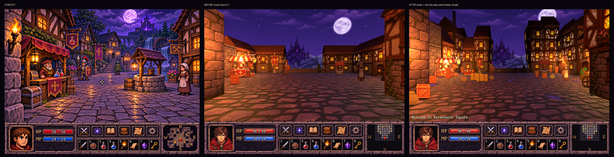

# Visual Direction Plan — getting from "experiment 1" to the concept art

## Where we are

Experiment 1 (the town square demo in `game-1/`) proved the hybrid renderer works:
grid movement with 90° turns, painted wall panels on simple 3D geometry, billboard
sprites with blob shadows, a parallax backdrop, ink-outlined cobblestones, and a
painted UI panel at 640×480. It looks good, but it does not have the feel of
`docs/concept-toonish.png`: the world looks **emptier and less curated**.

## Diagnosis

The gap is mostly **content and composition**, not rendering technique. Compared with
the concept, the demo lacks:

| The concept has | The demo has |
|---|---|
| ~25 distinct objects in a single view (flower boxes, ivy, signs, awning, crates, barrels, lanterns, waterfall, water wheel, stairs) | 14 props across the whole square |
| Every building unique: jettied upper floors, dormers, chimneys, varied heights | One 1×1.5 tile panel repeated, identical roofs |
| Vertical layering: stairs, raised areas, castle on its hill, aqueduct | A flat map |
| Overlap and framing: foreground objects, a torch-lit wall cutting into the frame | One object per tile, evenly spaced |
| Lighting that composes the picture (warm pools leading the eye, wet reflections) | Even lighting |

Any approach that doesn't address these will still feel empty.

## Strategy

Keep the current engine and combine three complementary techniques, plus one
exploratory experiment.

### 1. Content density (option 4)

Make the world feel lived-in with modular content and placement rules. Cheapest,
and probably the largest single improvement.

- **Building kit**: more modular parts instead of one flat panel per tile —
  jettied (overhanging) upper floors, dormers, chimneys, balconies, external stairs,
  varied wall heights and roof shapes.
- **Rule-based wall dressing**: signs, flower boxes, ivy, lanterns, shutters placed
  by rules ("flower box under 30% of upper windows", "ivy on corners near greenery").
- **Clutter generator**: crates, barrels, sacks, puddles, weeds along wall bases and
  in corners, with a seed so results are stable and editable.
- **Free placement**: several props per tile, offset from tile centres; props can
  overlap and frame views.
- **Height**: stairs, raised platforms and steps (revisits the "flat maps" decision).
- **Composed lighting**: lights placed deliberately per scene, not just per prop.

### 2. AI-painted unique textures on blockout geometry (option 5)

The classic matte-painting technique (camera projection), with an image model doing
the painting:

1. Block out the location as simple 3D geometry (the engine already builds it from
   the tile map).
2. Render a view as **depth + edge maps**.
3. Have an image model paint that view in the concept's style, **conditioned on the
   depth/edges** so the painting matches the geometry.
4. **Project** the painting back onto the geometry from that camera, baking it into
   per-surface textures.
5. For surfaces the first view didn't cover, render from another tile and have the
   model **inpaint only the missing parts**, using what's already painted as context.
6. Repeat until the location is covered.

Result: every building gets its own hand-painted texture instead of a repeated panel;
objects stay consistent across views (same geometry, same texture); movement and real
3D are kept. Prior art: StableProjectorz, Dream Textures (projection mode),
TEXTure-style multi-view texturing.

**Requirement**: an image model that accepts depth/edge conditioning and inpainting
(Stable Diffusion / Flux with ControlNet, locally or via a hosted API). ChatGPT's
image generation cannot do this.

### 3. View cards for key moments (option 6)

Fully painted images for specific `(tile, facing)` pairs — arriving in the square, a
city gate, a throne room, a vista — shown instead of (or layered over) the 3D render,
with crossfades on arrival and departure. Live elements (NPCs, torches) can still
be drawn on top using a depth proxy. Maximum polish exactly where players stop and look.

Because the camera only ever has 4 views per tile, every view of a map is
enumerable. A **view audit tool** that renders all views of a location as a contact
sheet would let a designer review, dress and pick view-card candidates view by view.

### 4. Experiment: generate a 3D world from the concept art (option 7)

New world-generation models can turn a single image into an explorable 3D scene
(typically Gaussian splats). Worth a quick, time-boxed test: feed it the concept art
and walk the result on our grid.

Expected issues: crisp pixel art tends to blur; unseen areas are invented; the output
is hard to edit or attach game logic to. Even if it isn't usable directly, it may be
useful as a source for blockouts or as a reference for composition.

## Options considered and set aside

- **AI-generate every view** (option 1): ~4 views per walkable tile (≈180 for the 9×9
  square, ≈1,200 for a 32×32 dungeon). Consistency between neighbouring views,
  regeneration on every map edit, overlays for anything dynamic, and crossfade-only
  movement make it suitable only for small hubs — which is what view cards cover.
- **Eye of the Beholder-style 2D compositing** (option 2): makes structure more
  repetitive, not less; poor fit for vertical layering and outdoor spaces.
- **High-quality 3D assets with hand-drawn shaders** (option 3): viable, but the cost
  is asset production and art direction; shaders are the easy part. Option 5 gets the
  painted look without hand-modelling and texturing everything.
- **Real-time AI restyling of every frame** (option 8): temporal flicker and compute
  cost make it impractical in the browser today.

## Plan of experiments

Each experiment is small, judged against the concept art, and builds on the current
engine.

1. **Projection painting, single view** (decides option 5)
   - Render the start view of the square as depth + edges.
   - Paint it with a depth/edge-conditioned model in the concept's style.
   - Project it onto the geometry; walk 1–2 tiles in each direction.
   - *Success*: it reads as one painting from the start tile and holds up within a
     couple of tiles; stretching and gaps are manageable.
2. **Projection painting, whole square**: multi-view coverage with inpainting; bake to
   textures; check consistency from every tile.
3. **Density pass**: building kit (jetties, dormers, chimneys, stairs), wall-dressing
   rules, clutter generator, free prop placement, composed lighting.
4. **View cards**: engine support (show/crossfade per tile+facing, sprites on top)
   and one card for the square's entrance view.
5. **View audit tool**: contact sheet of all views of a location.
6. **World-generation test** (option 7): time-boxed; concept art in, walk it on the grid.

Experiments 1 and 3 are independent and can run in parallel.

## Progress

### Experiment 3, first pass: scale and density (placeholder art)

- **Real-world scale.** Heights in level data are now in metres (`level.scale`:
  tile 3 m, eye 1.6 m, storeys 2.5 / 2.35 m). People were 0.88 tiles (≈2.6 m),
  taller than the painted doors; they are now ~1.75 m. The cobblestones are finer
  (`floorScale` 1.5).
- **Building kit.** Facades are split into ground storey, upper storey and eave
  strip (`storeys` in the manifest) and stacked into 2–4 storey houses with varied
  heights, jettied upper floors, roofs of varying pitch, and chimneys. Upper storeys
  mix facade textures. Per-tile overrides in `level.buildings` compose key views.
- **Rule-based dressing** (`engine/dressing.js`, seeded): flower boxes, ivy, door
  lanterns with lights, hanging signs, clutter groups along wall bases (stacked
  crates, barrels, sacks, firewood, hay, pots), corner clusters, weeds and glossy
  puddles. Doorways are kept clear; `exclude` keeps tiles empty.
- **Free placement**: several props per tile, stacking (`y`), floor decals.
  Unnamed entities are scenery (never block, never described, not on the minimap).

Still to do from the density pass: stairs and raised areas (needs the height
decision), shutters/dormers/balconies, deliberate light composition (pools and
dark gaps), and real art for the new props. The open middle of the square is the
weakest part of the start view; camera framing (lower horizon/tighter FOV) or a
smaller square is worth trying next.

## Open questions

- Which image model and where: local (GPU available?) or hosted API, and budget.
- Flat maps vs height: the density pass wants stairs and raised areas.
- How far projection painting should go: buildings only, or floor and props too?
- Style source: keep the concept art as the reference, or produce a short style guide
  (palette, line weight, lighting) to condition generation consistently?
